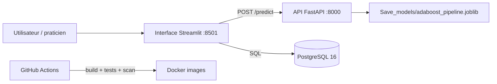
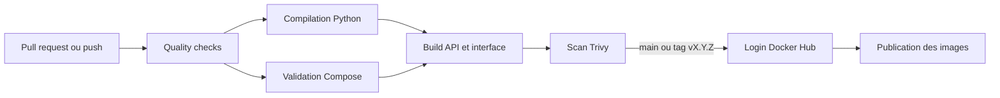

<div align="center">
  
  <h1>OncoScan AI</h1>
  <p><strong>Projet MLOps de classification de tumeurs mammaires</strong></p>

  <p>
    
    
    
    
    
    
    
    
  </p>
</div>

> Avertissement : ce projet est un prototype pédagogique et ne remplace pas un avis médical professionnel. Il est conçu pour démontrer un workflow MLOps complet, pas pour servir de diagnostic clinique.

## Sommaire

- [1. Vue d'ensemble](#1-vue-densemble)
- [2. Architecture actuelle](#2-architecture-actuelle)
- [3. Modèle et données](#3-modèle-et-données)
- [4. Déploiement local avec Docker](#4-déploiement-local-avec-docker)
- [5. Utilisation de l'application](#5-utilisation-de-lapplication)
- [6. Variables d'environnement](#6-variables-denvironnement)
- [7. Structure du dépôt](#7-structure-du-dépôt)
- [8. Tests et validation](#8-tests-et-validation)
- [9. CI/CD](#9-cicd)
- [10. Dépannage](#10-dépannage)
- [11. Licence](#11-licence)

## 1. Vue d'ensemble

OncoScan AI est une application de démonstration MLOps pour classifier des tumeurs mammaires à partir de variables morphologiques. Le modèle est entraîné sur un jeu de données de référence et encapsulé dans un pipeline scikit-learn sauvegardé au format `joblib`.

Le projet actuel contient :

- une interface web Streamlit pour la saisie et l'historique,
- une API FastAPI pour l'inférence,
- une base PostgreSQL pour les comptes et les prédictions,
- un script de training `Model/train.py`,
- des tests de validation de performance du modèle,
- une pipeline CI/CD GitHub Actions pour build, test et scan de conteneurs.

## 2. Architecture actuelle

Le dépôt est structuré autour de trois services principaux orchestrés par Docker Compose :



### Services

- `Interface/` : application Streamlit avec authentification, validation des valeurs, appel à l'API et historique en base.
- `Api/` : API FastAPI exposant `/health` et `/predict` avec validation Pydantic et clé API.
- `Database/` : script SQL initialisant le schéma PostgreSQL.
- `Save_models/` : artefacts ML sérialisés utilisés au runtime.

### Ports et connexions

- `http://localhost:8501` : interface publique
- `http://api:8000/predict` : endpoint interne de l'API depuis le réseau Docker
- `postgres:5432` : base de données interne, inaccessible directement depuis l'hôte

## 3. Modèle et données

### Modèle ML

Le projet utilise un pipeline de type `Pipeline([('scaler', MinMaxScaler()), ('model', model)])` avec des modèles comparés dans `Model/train.py`.

Le meilleur modèle actuellement sauvegardé est :

- `Save_models/adaboost_pipeline.joblib`

Le pipeline est chargé par FastAPI au démarrage et est validé via les tests.

### Variables du modèle

Le modèle attendu par l'API et l'interface prend 5 variables :

- `perimeter`
- `concave_points`
- `texture`
- `smoothness`
- `symmetry`

Les bornes de validation utilisées par l'API sont :

| Champ | Bornes |
|---|---|
| `perimeter` | `40.0 < x <= 250.0` |
| `concave_points` | `0.0 <= x <= 0.3` |
| `texture` | `5.0 < x <= 50.0` |
| `smoothness` | `0.01 < x <= 0.3` |
| `symmetry` | `0.05 < x <= 0.7` |

### Données

Les jeux de données et évaluations sont présents dans :

- `Data/raw/`
- `Data/process/`
- `Data/evaluate/`

Le dataset de validation utilisé par les tests est :

- `Data/process/cancer_select.csv`

Les résultats d'évaluation sont stockés dans :

- `Evaluate_results/metrics.json`
- `Evaluate_results/confusion_matrix.png`

### API REST

L'API expose les endpoints suivants :

#### `GET /`

Retourne le nom, la version et le statut de l'application.

#### `GET /health`

Retourne l'état du pipeline chargé :

```json
{
  "status": "healthy",
  "pipeline_loaded": true,
  "model_version": "2.0.0"
}
```

#### `POST /predict`

Exemple de payload :

```json
{
  "perimeter": 87.46,
  "concave_points": 0.04781,
  "texture": 17.77,
  "smoothness": 0.08474,
  "symmetry": 0.1812
}
```

Exemple de réponse :

```json
{
  "prediction": "M",
  "label": "Maligne",
  "probability_malignant": 0.923,
  "model_version": "2.0.0"
}
```

La clé API est attendue dans le header HTTP :

```http
X-API-Key: votre-cle-api
```

## 4. Déploiement local avec Docker

### 4.1 Prérequis

- Docker Desktop ou Docker Engine
- Docker Compose v2
- Git
- Python 3.12 (recommandé pour les vérifications locales)

### 4.2 Cloner le dépôt

```bash
git clone https://github.com/<votre-utilisateur>/<votre-repository>.git
cd MLops-Project-Tuto-Python
```

### 4.3 Préparer les variables d'environnement

Créez votre fichier `.env` à partir de l'exemple :

```bash
cp .env.example .env
```

Sur PowerShell :

```powershell
Copy-Item .env.example .env
```

Exemple de contenu attendu :

```dotenv
DB_NAME=oncoscan
DB_USER=oncoscan
DB_PASSWORD=replace-with-a-long-random-password
API_KEY=replace-with-a-long-random-api-key
ALLOWED_ORIGINS=
VERSION=2.0.0
```

### 4.4 Démarrer les services

```bash
docker compose config --quiet
docker compose up --build -d
```

Vérifier l'état :

```bash
docker compose ps
docker compose logs -f
```

L'application est ensuite accessible sur :

- Interface : http://localhost:8501
- API : http://localhost:8000/docs

### 4.5 Arrêt et nettoyage

```bash
docker compose down
```

Pour supprimer aussi la base de données locale :

```bash
docker compose down -v
```

## 5. Utilisation de l'application

### 5.1 Authentification

L'interface Streamlit permet :

- la création d'un compte,
- la connexion à un compte existant,
- la vérification du mot de passe via `bcrypt`,
- la limitation des tentatives de connexion afin de limiter les attaques de force brute.

### 5.2 Saisie des données

L'utilisateur renseigne les 5 variables nécessaires à la prédiction :

- périmètre,
- points concaves,
- texture,
- lissitude,
- symétrie.

Le formulaire valide les bornes directement côté interface avant l'appel à l'API.

### 5.3 Historique

Les résultats sont stockés dans la table `predictions` avec :

- l'ID utilisateur,
- l'ID patient,
- les variables utilisées,
- la prédiction (`M` ou `B`),
- la probabilité de malignité,
- le timestamp de création,
- un feedback éventuel médical.

## 6. Variables d'environnement

| Variable | Services | Description |
|---|---|---|
| `DB_NAME` | PostgreSQL, interface | Nom de la base de données |
| `DB_USER` | PostgreSQL, interface | Utilisateur PostgreSQL |
| `DB_PASSWORD` | PostgreSQL, interface | Mot de passe PostgreSQL |
| `API_KEY` | API, interface | Clé utilisée pour sécuriser `/predict` |
| `ALLOWED_ORIGINS` | API | Origines CORS autorisées (optionnel) |
| `VERSION` | Docker Compose | Tag/version appliquée aux images |
| `APP_VERSION` | Interface | Version affichée dans l'UI |
| `API_URL` | Interface | URL de l'API interne |
| `MODEL_PATH` | API | Chemin du joblib du modèle dans le conteneur |
| `MODEL_VERSION` | API | Version du modèle exposée dans les réponses |
| `ALLOW_REGISTRATION` | Interface | Active ou désactive la création de comptes |

Ne stockez jamais les secrets dans le dépôt. Les valeurs sensibles doivent rester dans `.env` ou un système de secret manager en environnement réel.

## 7. Structure du dépôt

```text
MLops-Project-Tuto-Python/
├── .github/
│   └── workflows/
│       └── ci_cd_oncoscan.yml
├── Api/
│   ├── api.py
│   ├── Dockerfile
│   └── requirements_api.txt
├── Data/
│   ├── evaluate/
│   ├── process/
│   └── raw/
├── Database/
│   └── schema.sql
├── Evaluate_results/
│   ├── confusion_matrix.png
│   └── metrics.json
├── Interface/
│   ├── .streamlit/
│   ├── app.py
│   ├── Dockerfile
│   ├── favicon.svg
│   ├── requirements_interface.txt
│   └── style.css
├── Model/
│   └── train.py
├── Save_models/
│   └── adaboost_pipeline.joblib
├── Tests/
│   └── test_model.py
├── .dockerignore
├── .env.example
├── .gitignore
├── LICENSE
├── README.md
├── docker-compose.yml
├── commandes_git.txt
├── recup_donnees.txt
└── .report.json
```

## 8. Tests et validation

Le projet intègre des tests de qualité du pipeline :

```bash
pytest Tests/test_model.py -q
```

Les tests vérifient notamment :

- présence et intégrité des données,
- encodage correcte de la cible (`M`/`B` vers `1`/`0`),
- recall, précision, F1-score et AUC,
- robustesse de l'inférence sur des échantillons isolés,
- stabilité de la prédiction.

La validation est aussi faite dans GitHub Actions, qui compile le code Python et valide le fichier Docker Compose.

## 9. CI/CD

Le workflow GitHub Actions est présent dans :

- `.github/workflows/ci_cd_oncoscan.yml`

Il contient :

- l'installation des dépendances Python,
- le lancement des tests `pytest`,
- la génération d'un rapport JSON de test,
- la compilation du code Python,
- la validation de `docker-compose.yml`,
- la construction des images API et interface,
- le scan de vulnérabilités avec Trivy,
- le smoke test de démarrage des conteneurs,
- la publication sur Docker Hub sur `main` ou sur un tag `vX.Y.Z`.

## 10. Dépannage

### Problème : la base de données ne se crée pas

Vérifier le contenu de `.env` et la présence des variables :

```bash
docker compose config
```

### Problème : l'API ne démarre pas

Vérifier la présence du modèle :

```bash
ls -l Save_models
```

Ensuite :

```bash
docker compose logs api
```

### Problème : l'interface ne peut pas se connecter à PostgreSQL

Dans Docker, l'interface doit utiliser `DB_HOST=postgres` et non `localhost`.

```bash
docker compose logs interface postgres
```

### Problème après modification du schéma SQL

Le schéma de PostgreSQL est exécuté uniquement lors de la première initialisation du volume.

Pour repartir proprement :

```bash
docker compose down -v
docker compose up --build -d
```

## 11. Licence

Ce projet est distribué sous la licence MIT. Voir le fichier [LICENSE](LICENSE).

---

<div align="center">
  <strong>OncoScan AI</strong> · Projet pédagogique MLOps · 2026
</div>
```

## 8. Services

### Interface web — `Interface/`

Technologie : Streamlit.

Responsabilités : authentification des praticiens, saisie contrôlée, appel REST, affichage du résultat et consultation de l'historique PostgreSQL.

Dépendances : `Interface/requirements_interface.txt`.

### API d'inférence — `Api/`

Technologies : FastAPI, Uvicorn, Pydantic, pandas et scikit-learn.

Responsabilités : charger et vérifier les artefacts, valider les requêtes JSON, exécuter l'inférence et fournir les endpoints REST et de santé.

Dépendances : `Api/requirements_api.txt`.

### Base de données — `Database/`

Technologie : PostgreSQL 16 Alpine.

`Database/schema.sql` crée les tables `users` et `predictions`, la relation `predictions.user_id -> users.id`, les contraintes de bornes et les index nécessaires à l'historique.

Le script d'initialisation n'est exécuté automatiquement que lors de la création initiale du volume. En production, une évolution de schéma doit passer par une migration versionnée.

## 9. Dockerfiles et Compose

### Construction des images

Les deux Dockerfiles utilisent une construction multi-stage :

1. une étape builder installe les dépendances ;
2. une image runtime séparée reçoit uniquement l'environnement et le code nécessaires ;
3. le processus s'exécute avec un utilisateur non-root ;
4. un healthcheck vérifie le service ;
5. l'image expose uniquement le port interne nécessaire.

L'API démarre avec Uvicorn sur `8000`. L'interface démarre avec Streamlit sur `8501`.

### Orchestration Compose

`docker-compose.yml` :

- démarre PostgreSQL avec un healthcheck ;
- monte `Database/schema.sql` en lecture seule à l'initialisation ;
- monte les modèles en lecture seule dans l'API ;
- attend que PostgreSQL et l'API soient healthy avant l'interface ;
- injecte les variables nécessaires par service ;
- conserve les données dans `pgdata` ;
- publie uniquement le port `8501` sur l'hôte.

## 10. CI/CD et Docker Hub

Le workflow [`.github/workflows/ci-cd.yml`](.github/workflows/ci-cd.yml) suit ce flux :



### Déclencheurs

- pull request vers `main` : contrôles, build et scan, sans publication ;
- push sur `main` : contrôles, build, scan et publication ;
- tag `vX.Y.Z` : contrôles, build, scan et publication ;
- lancement manuel avec `workflow_dispatch`.

### Étapes automatisées

1. compilation de `Api/` et `Interface/` ;
2. validation de `docker-compose.yml` avec des variables CI ;
3. build des deux images avec Buildx et cache GitHub Actions ;
4. scan Trivy des vulnérabilités `HIGH` et `CRITICAL` ;
5. publication uniquement si toutes les étapes précédentes réussissent.

### Secrets GitHub

Dans **Settings → Secrets and variables → Actions**, créer :

| Secret | Contenu |
|---|---|
| `DOCKERHUB_USERNAME` | Nom du compte Docker Hub |
| `DOCKERHUB_TOKEN` | Access Token Docker Hub, jamais le mot de passe du compte |

Repositories Docker Hub attendus :

- `<DOCKERHUB_USERNAME>/oncoscan-api`
- `<DOCKERHUB_USERNAME>/oncoscan-interface`

### Versionner et publier

```bash
git add .
git commit -m "release: prepare v1.4.0"
git push origin main
```

Pour une version immuable :

```bash
git tag v1.4.0
git push origin v1.4.0
```

Le workflow produit notamment `latest`, `sha-<commit>` et `v1.4.0` pour un tag Git.

## 11. Variables d'environnement

| Variable | Services | Rôle |
|---|---|---|
| `DB_NAME` | PostgreSQL, interface | Nom de la base |
| `DB_USER` | PostgreSQL, interface | Utilisateur PostgreSQL |
| `DB_PASSWORD` | PostgreSQL, interface | Mot de passe PostgreSQL |
| `API_KEY` | API, interface | Authentification des appels `/predict` |
| `ALLOWED_ORIGINS` | API | Origines CORS autorisées, facultatif |
| `VERSION` | Compose | Tag local des images |
| `API_URL` | Interface | URL interne de l'endpoint de prédiction |
| `MODEL_PATH` | API | Chemin du modèle dans le conteneur |
| `SCALER_PATH` | API | Chemin du scaler dans le conteneur |

Les valeurs sensibles doivent rester dans `.env` localement ou dans un gestionnaire de secrets en production. `.env.example` ne contient aucune valeur réelle.

## 12. Structure du projet

```text
API-Docker-GithubActions/
├── .github/workflows/ci-cd.yml        # Pipeline GitHub Actions
├── Api/
│   ├── api.py                         # API FastAPI et inférence
│   ├── Dockerfile                     # Image de l'API
│   └── requirements_api.txt           # Dépendances API
├── Database/schema.sql                 # Schéma PostgreSQL
├── Interface/
│   ├── app.py                         # Interface Streamlit
│   ├── Dockerfile                     # Image de l'interface
│   ├── favicon.svg                    # Favicon OncoScan
│   └── requirements_interface.txt     # Dépendances Streamlit
├── Save_models/
│   ├── decision_tree_best.pkl         # Modèle pré-entraîné
│   └── MinMax_scaler.pkl              # Scaler pré-entraîné
├── .dockerignore
├── .env.example
├── .gitignore
├── docker-compose.yml
├── LICENSE
└── README.md
```

## 13. Dépannage

### Variable Compose manquante

```bash
docker compose config
```

Vérifier que `.env` contient `DB_NAME`, `DB_USER`, `DB_PASSWORD`, `API_KEY` et `VERSION`.

### API unhealthy

```bash
docker compose logs api
```

Vérifier la présence de :

```text
Save_models/decision_tree_best.pkl
Save_models/MinMax_scaler.pkl
```

### Interface et PostgreSQL

L'interface doit utiliser `DB_HOST=postgres`, jamais `localhost` dans Docker.

```bash
docker compose ps
docker compose logs postgres interface
```

### Schéma non mis à jour

Les scripts d'initialisation ne sont joués qu'une fois par volume. Pour une démonstration sans données à conserver :

```bash
docker compose down -v
docker compose up --build -d
```

En production, appliquer une migration contrôlée et sauvegarder la base avant toute modification.

## 14. Limites et évolutions

Pour une production médicale réelle, prévoir notamment :

- migrations de base de données versionnées ;
- tests unitaires et tests d'intégration automatisés ;
- gestion de secrets dédiée ;
- HTTPS derrière un reverse proxy ;
- authentification avec sessions sécurisées ;
- journalisation et supervision centralisées ;
- validation clinique, traçabilité et gouvernance des modèles ;
- versionnement des modèles et vérification de leur empreinte ;
- limitation de débit et sauvegardes PostgreSQL.

## 15. Licence

Ce projet est distribué sous licence MIT. Voir [LICENSE](LICENSE).

Copyright (c) 2026 @Madiba

---

<div align="center">
  <strong>OncoScan AI</strong> · Projet pédagogique MLOps · @Madiba
</div>
